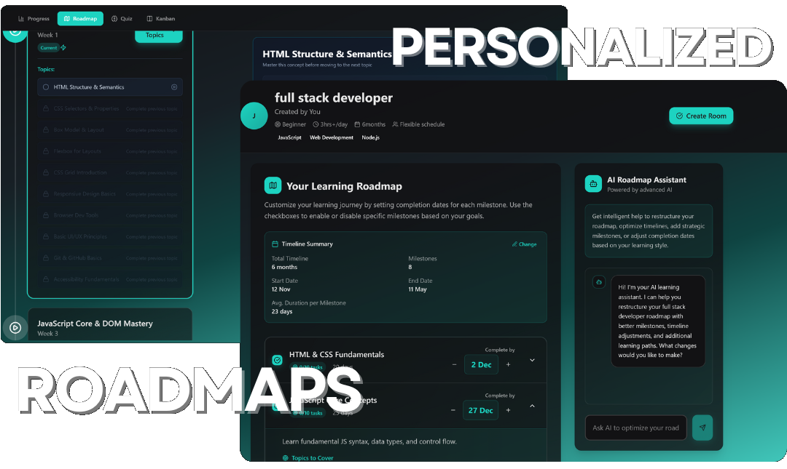
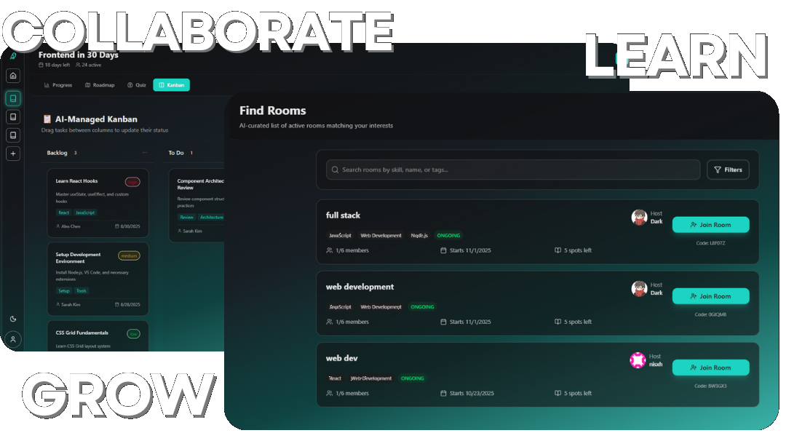
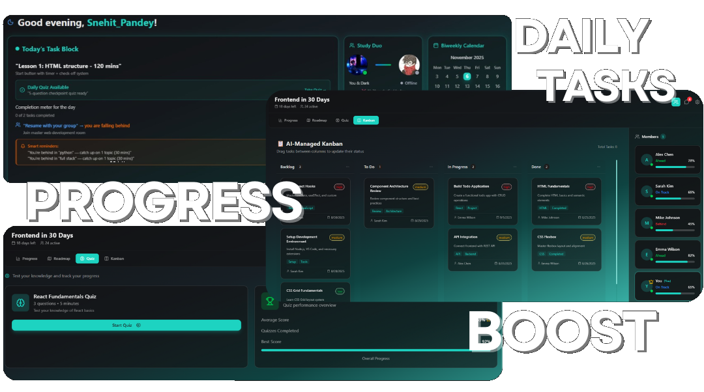
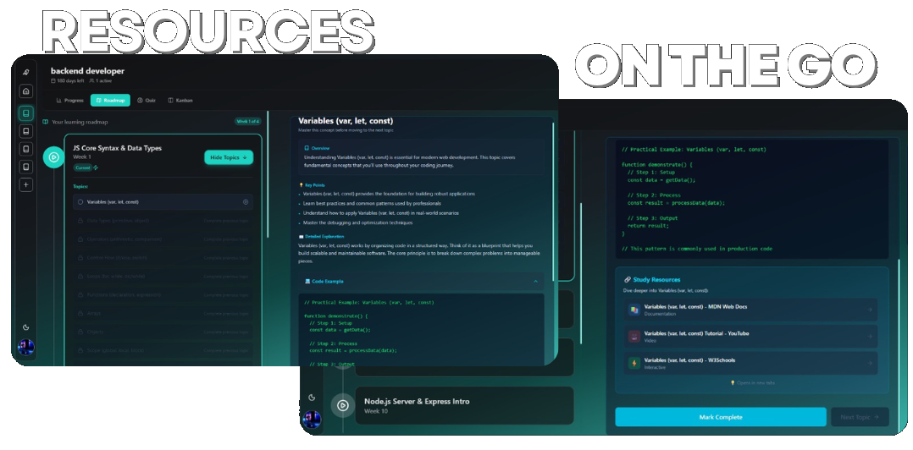

<div align="center">

# ⚡ LearnCurve (FocusKami)

### *AI-Powered Peer-to-Peer Collaborative Learning Platform*

[](https://learncurve-m.netlify.app/)
[](https://learncurve.onrender.com/)

[](https://react.dev/)
[](https://vitejs.dev/)
[](https://tailwindcss.com/)
[](https://www.framer.com/motion/)
[](https://socket.io/)
[](LICENSE)

<br />

<p align="center">
  <b>Transforming isolated studying into an interactive, structured, and gamified group flow.</b><br />
  Combines dynamic AI curriculum synthesis, real-time peer study rooms, live Kanban task orchestration, and social accountability duos into a single, cohesive experience.
</p>

[Explore Live Demo](https://learncurve-m.netlify.app/) • [Report Bug](https://github.com/SnehitPandey/Learncurve-main/issues) • [Request Feature](https://github.com/SnehitPandey/Learncurve-main/issues)

</div>

---

## 📸 Feature Showcase

| 🤖 Personalized AI Roadmaps | 👥 Collaborative Study Rooms |
|:---:|:---:|
|  |  |
| *Dynamically calibrated to your target timeframe, daily study budget, and proficiency level.* | *Virtual spaces with multi-tab presence tracking, live chat, and group sprint synchronization.* |

| 📋 Dynamic Kanban Tracking | 📚 Curated Resource Library |
|:---:|:---:|
|  |  |
| *5-column progression with drag-and-drop sync, streak ledgers, and adaptive re-planning.* | *Integrated guides, checklists, and checkpoint quizzes with automatic progress validation.* |

---

## ✨ Core Platform Capabilities

### 🤖 1. AI Curriculum Synthesis & Adaptive Roadmaps
* **Intelligent Study Budget Engine:** Analyzes timeframes, skill benchmarks, daily commitment (`30m`, `1hr`, `2hrs`, `3hrs+`), and scheduling availability (`weekdays`, `weekends`, `anytime`) to calculate the exact calendar distribution of study days and milestone deadlines.
* **In-Room AI Assistant:** Allows real-time modification of active roadmaps. Learners can prompt the assistant to regenerate specific modules (*"make it more hands-on"*, *"step up the difficulty"*) with live preview and complete undo/redo history.
* **Adaptive Re-Plan Engine:** If a room falls behind, creators can recalculate and extend upcoming unstarted modules from the current date forward while strictly locking completed milestones to preserve historical achievements.

### 👥 2. Real-Time Collaborative Study Rooms
* **Multi-Tab Socket Presence:** Tracks real-time presence through a socket reference-counting architecture (`roomSockets -> activeRoomUsers`). Online indicators accurately reflect active participation even when users browse across multiple browser tabs.
* **Live In-Room Discussions:** Real-time group messaging with Markdown formatting, attachment verification, client-side optimistic reconciliation, and sliding-window rate limiting.
* **Synchronized Study Sprints:** Coordinated study timers and daily milestone targets kept in lockstep across all room members.

### 📋 3. Live Synchronized Kanban Board
* **Automated 5-Column Workflow:** Automatically categorizes tasks into *Upcoming*, *Backlog*, *To Do*, *In Progress*, and *Done* based on module deadlines and calendar progression.
* **Peer Synchronization:** Dragging cards across columns emits atomic updates that instantly update all connected room members via Socket.IO.
* **Atomic Progress Ledger:** Dragging tasks to *Done* records verified task completions, awards XP, and updates daily study streaks without race conditions.

### 🤝 4. Study Duo Accountability
* **1-on-1 Peer Pairing:** Direct peer matching via shareable invite codes (`/connect/:code`).
* **Mutual Activity & Streak Sync:** Tracks partner online presence, compares daily completion status, and logs shared study streaks.
* **Privacy-Preserving Day Verification:** Computes duo mutual status server-side to protect individual user study logs while confirming mutual milestone achievement.

### 🎯 5. Anti-Cheat Checkpoint Quizzes
* **Dynamic Variant Generation:** Serves 1 of 8 deterministically shuffled question variants per test attempt.
* **Server-Side Grading:** Strips answer keys and explanations from API payloads before transmission. Evaluates scores server-side and automatically marks corresponding daily milestones complete upon scoring $\ge 80\%$.

### 🎨 6. Modern Glassmorphic Design System
* **Tailwind CSS v4 & Glassmorphism:** Sleek, spatial UI with fluid gradients, backdrop blurs, and responsive mobile-first layouts.
* **Framer Motion Micro-Interactions:** Smooth drag-and-drop feedback, animated progress bars, and modal physics.
* **Dynamic Theming:** Seamless dark/light theme switching with user-selectable accent color presets (*teal*, *sky*, *indigo*, *rose*).

---

## 🛠️ Fullstack Technology Stack

```
┌────────────────────────────────────────────────────────────────────────┐
│                          FRONTEND (Netlify)                            │
│  React 19  •  Vite 7  •  Tailwind CSS v4  •  Framer Motion  •  Router v7 │
└───────────────────────────────────┬────────────────────────────────────┘
                                    │ HTTPS (REST) / WSS (Socket.IO)
┌───────────────────────────────────▼────────────────────────────────────┐
│                           BACKEND (Render)                             │
│      Node.js  •  Express 4  •  TypeScript 5.7  •  Socket.IO Server      │
└──────────────┬────────────────────┬────────────────────┬───────────────┘
               │                    │                    │
               ▼                    ▼                    ▼
     ┌──────────────────┐  ┌──────────────────┐  ┌──────────────┐
     │     Supabase     │  │  MongoDB Atlas   │  │   Groq AI    │
     │  PostgreSQL 15   │  │    (Mongoose)    │  │  Dual-Pool   │
     │  Storage Buckets │  │ Dynamic Content  │  │  Fast LLM    │
     └──────────────────┘  └──────────────────┘  └──────────────┘
```

| Layer | Technologies | Responsibilities |
|---|---|---|
| **Client UI & State** | React 19, React Router v7 | Single-page application, route protection, declarative components |
| **Bundler & Tooling** | Vite 7, PostCSS | Sub-second HMR, tree-shaking, production optimization |
| **Styling & Effects** | Tailwind CSS v4, Framer Motion | Design tokens, CSS variables, glassmorphic themes, fluid animations |
| **Icons & DnD** | Lucide React, React Icons, @hello-pangea/dnd | UI iconography, accessible Kanban card drag-and-drop |
| **Real-Time Client** | Socket.IO Client v4 | Multi-transport WebSocket client with heartbeat and auto-reconnect |
| **Server Engine** | Node.js, Express 4, TypeScript 5.7 | Strongly-typed RESTful endpoints and WebSocket event dispatching |
| **Relational Data** | Supabase (PostgreSQL 15) | User identity, auth, room metadata, reward ledger, streaks |
| **Document Store** | MongoDB Atlas (Mongoose) | Hierarchical roadmaps, multi-variant quizzes, Kanban cards, chats |
| **Artificial Intelligence** | Groq SDK (`qwen/qwen3.6-27b`) | Dual-key failover inference for curriculum planning & test synthesis |
| **Security & Auth** | Google OAuth 2.0, JWT, BcryptJS | Confidential authorization-code flow, versioned token revocation |

---

## 📁 Frontend Directory Architecture

```text
Frontend/
├── public/
│   ├── _redirects                  # Client-side SPA routing rewrite rules
│   └── assets/
│       ├── icons/                  # Brand SVG and PNG icons
│       └── images/                 # Feature preview mockups & illustrations
│           ├── personalized-roadmaps.png
│           ├── collaborate.png
│           ├── boost-progress.png
│           └── resources.png
├── src/
│   ├── api/                        # HTTP client & service endpoints
│   │   ├── auth.js                 # Authentication & Google OAuth initiation
│   │   ├── client.js               # Fetch wrapper with 401 retry & token refresh
│   │   ├── rooms.js                # Room discovery, creation, and member APIs
│   │   └── users.js                # Profile updates, avatar uploads, CV documents
│   ├── Components/                 # Modular component hierarchy
│   │   ├── auth/                   # Google button, verification modals
│   │   ├── elements/               # Buttons, theme toggles, LightPillars, badges
│   │   ├── landing/                # Hero section, feature showcases, FAQ, footer
│   │   ├── layout/                 # Global navigation shell, sidebars, bottombar
│   │   └── room/                   # Kanban boards, roadmap editor, chat overlay
│   ├── Pages/                      # Top-level view controllers
│   │   ├── App/                    # Dashboard, Study Room, Duo Hub, Settings, Profile
│   │   ├── Static/                 # Landing, About, Contact, Terms, 404
│   │   ├── AuthCallback.jsx        # OAuth code exchange and session establishment
│   │   ├── login.jsx               # Sign-in portal
│   │   └── signup.jsx              # Registration portal
│   ├── sockets/                    # WebSocket client integration
│   │   ├── socketClient.js         # Singleton Socket.IO client with auto-reconnect
│   │   └── useRoomSocket.js        # Real-time room event hook and presence sync
│   ├── utils/                      # Chat reconciliation, date helpers, storage
│   ├── App.jsx                     # Master layout & error boundaries
│   ├── main.jsx                    # Application entry point & router definitions
│   ├── theme.js                    # Accent color management & theme tokens
│   └── index.css                   # Tailwind v4 directives & root CSS variables
├── netlify.toml                    # Netlify deployment configuration & headers
├── vite.config.js                  # Vite build settings & dev proxy rules
└── package.json                    # Project metadata & dependencies
```

---

## 🤝 Contributing

Contributions, issues, and feature requests are welcome!
Feel free to check the [issues page](https://github.com/SnehitPandey/Learncurve-main/issues).

---

## 📄 License

This project is licensed under the [MIT License](LICENSE).
